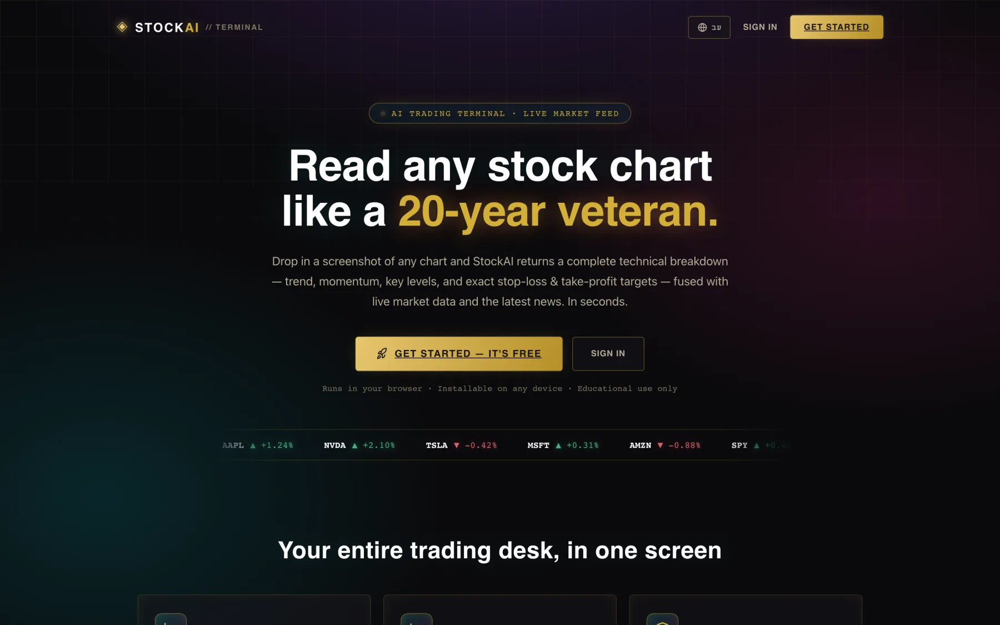
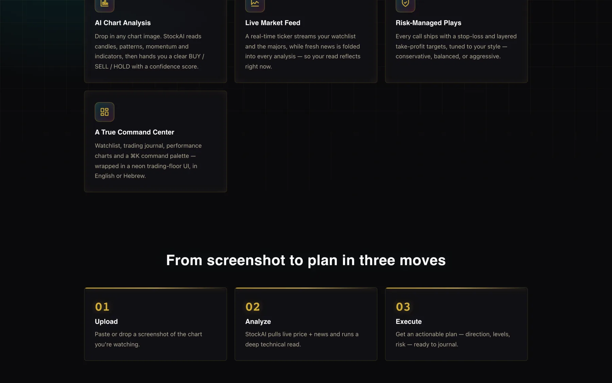

# StockAI

**Reads any chart like a 20-year veteran.**

Drop in a chart screenshot and StockAI returns a full technical breakdown — trend, momentum, key levels, stop-loss and targets — fused with live market data and news.




## Highlights

- Image analysis with Claude vision and structured output, including an A+→D setup grade and automatic fallback
- SL/TP, support and resistance drawn directly on the chart, calibrated to the price axis
- Paper portfolio with $100K virtual cash, auto-journaling and performance tracking
- Cross-device sync, a ⌘K command palette, bilingual UI and two themes

## Tech stack

Next.js 16 · Claude Sonnet (vision) · Clerk · Upstash Redis · Yahoo Finance · Brave Search

## Run locally

```bash
npm install
cp .env.example .env.local   # add your keys
npm run dev
```

Next.js app — open http://localhost:3000

> All secrets live in environment variables — see `.env.example`. No keys are committed to this repository.

---

<div dir="rtl">

## בעברית

**קורא כל גרף כמו סוחר ותיק.**

מעלים צילום של גרף, ו-StockAI מחזיר ניתוח טכני מלא — מגמה, מומנטום, רמות מפתח, סטופ ויעדים — משולב עם נתוני שוק חיים וחדשות.

- ניתוח תמונה עם Claude (vision) ופלט מובנה, כולל ציון סטאפ A+→D ו-fallback אוטומטי
- ציור רמות SL/TP, תמיכות והתנגדויות ישירות על תמונת הגרף, בכיול לפי ציר המחיר
- תיק דמו עם $100K וירטואליים, יומן מסחר אוטומטי ומעקב ביצועים
- סנכרון בין מכשירים, Command Palette (⌘K), דו-לשוני ושתי ערכות נושא

</div>

---

Part of my portfolio · built by [Ido](https://github.com/idorl1203-zaid)
